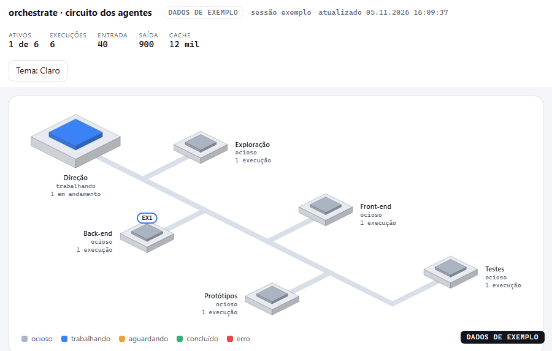
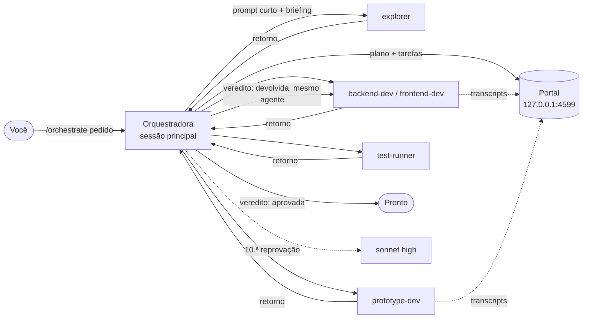
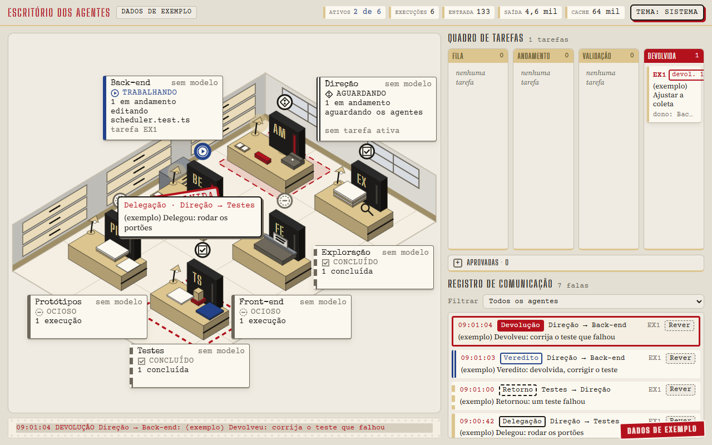
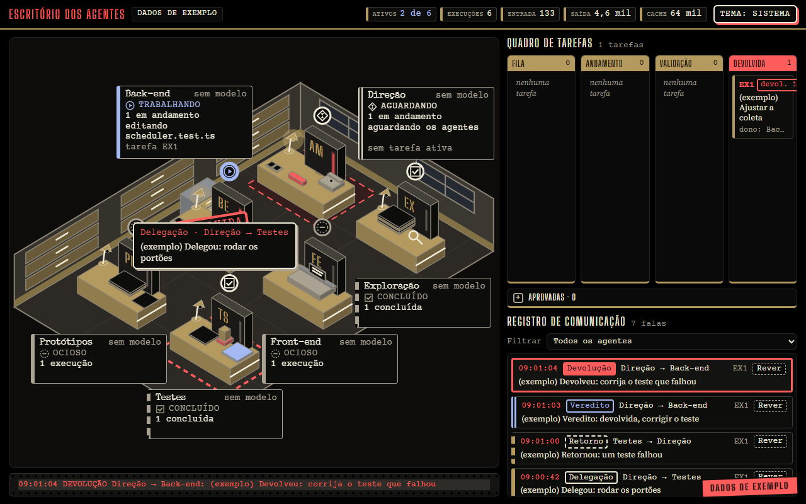
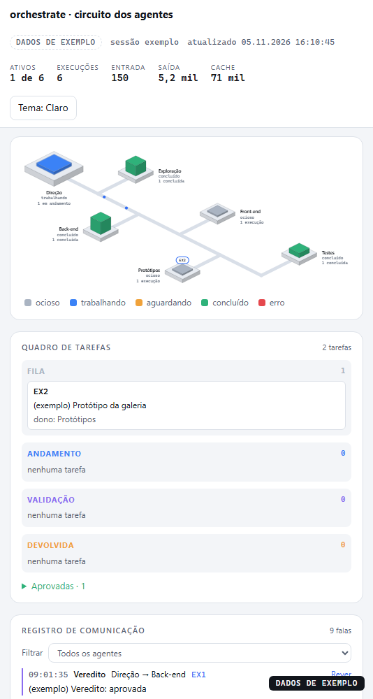

# orchestrate

**Uma skill do [Claude Code](https://claude.com/claude-code) que executa um pedido por um fluxo multiagente "barato primeiro", com um portal de "escritório" ao vivo mostrando o que cada agente está fazendo.**

🇺🇸 [Read in English](README.en.md)



> O GIF acima é o portal reproduzindo seus **dados de exemplo** embutidos (marcados como `DADOS DE EXEMPLO` na interface). Nada ali vem de uma sessão real.

## O que faz

`/orchestrate <pedido>` transforma a sessão principal do Claude Code em orquestradora, seguindo regras fixas:

1. **Planejar primeiro.** O pedido vira tarefas com ID, dono, caminhos exclusivos e critério de aceite verificável (de preferência um comando que sai 0).
2. **Haiku primeiro.** Subagentes rodam em `haiku`. Sonnet só entra após **10 entregas reprovadas** da mesma tarefa, e a orquestradora para após **mais 3** reprovações no sonnet.
3. **Prompts curtos.** O prompt de delegação tem no máximo 12 linhas e aponta para um arquivo de briefing em vez de colar contexto.
4. **Relato não é prova.** A orquestradora confere cada critério com evidência própria (diff, execução, captura de tela) antes de aceitar.
5. **Erro volta para o mesmo agente**, que ainda tem o contexto, em vez de abrir outro.
6. **Trabalho visual passa pelo portão de protótipos.** São gerados N protótipos e você escolhe um antes da versão final.



## O portal

A cada disparo a skill sobe um pequeno servidor local (Node, sem dependências, só em `127.0.0.1`) e imprime a URL na primeira linha da resposta. Numa única tela ele mostra:

- uma **mesa por agente**, com estado, atividade atual e uso de tokens;
- um **quadro de tarefas** (fila, andamento, validação, devolvida, aprovada);
- um **registro de comunicação** (delegações, retornos, vereditos, devoluções).

Ele lê os transcripts de sessão do Claude Code sozinho. O que só a orquestradora sabe (tarefas, falas, vereditos) entra por `emit.mjs`.

| Claro | Escuro | Celular |
|---|---|---|
|  |  |  |

> **Idioma.** A interface do portal, os subcomandos e flags do `emit.mjs` (`tarefa`, `fala`, `veredito`, `escalada`, `--titulo`, `--dono`, …) e os nomes de estado das tarefas são em **português**. O `SKILL.md` está em inglês e a documentação existe em português (`README.md`) e inglês (`README.en.md`); o `SKILL.md` informa ao modelo os comandos exatos em português. Interface traduzida ainda não existe.

## Requisitos

- Claude Code com suporte a skills e subagentes.
- Node.js 24 (versão em que o código foi desenvolvido e testado; versões anteriores não foram verificadas).
- Testado apenas no Windows 11. Nada no código é específico do Windows, mas macOS e Linux não foram verificados.

## Instalação

A skill é a pasta `skills/orchestrate/`. Escolha um local.

**Pessoal (todos os projetos):**

```bash
git clone https://github.com/edilsonvilarinho/orchestrator.git
cd orchestrator
mkdir -p ~/.claude/skills
cp -r skills/orchestrate ~/.claude/skills/orchestrate
```

PowerShell:

```powershell
New-Item -ItemType Directory -Force "$HOME\.claude\skills" | Out-Null
Copy-Item -Recurse skills\orchestrate "$HOME\.claude\skills\orchestrate"
```

**Só um projeto:** copie para `<projeto>/.claude/skills/orchestrate/`.

Reinicie o Claude Code (ou abra uma sessão nova) para ele carregar a skill. Confirme que `/orchestrate` aparece na lista de comandos.

### Agentes (configurados por projeto na primeira execução)

Na primeira `/orchestrate` em um projeto, a skill detecta que os agentes ainda não foram configurados (nenhum dos cinco em `<projeto>/.claude/agents/` e nenhuma escolha registrada) e, antes de planejar:

1. lê só os manifestos do projeto (`package.json`, `pom.xml`, `build.gradle*`, `go.mod`, `Cargo.toml`, `pyproject.toml`, `*.csproj`/`*.sln`) e mostra a stack e os comandos de teste/build encontrados;
2. pergunta se você quer **instalar os agentes para este projeto** ou **usar os genéricos**;
3. ao instalar, grava `explorer`, `test-runner`, `backend-dev`, `frontend-dev` e `prototype-dev` em `<projeto>/.claude/agents/` (a partir de `skills/orchestrate/agents/`, já com `model: haiku` e `effort: high`), cada um com uma seção `Project context` com stack, comandos e arquivos de regras (`CLAUDE.md`, `AGENTS.md`). Agente que já existe não é sobrescrito.

Comandos vindos dos scripts do `package.json` são tratados como declarados; os demais (ex.: `mvn test`) são o padrão do ecossistema e vêm marcados como **convenção, não verificada**. Nada é inferido além dos manifestos.

Se os agentes novos não aparecerem para delegação, reinicie a sessão (ou use `/agents`) e repita o pedido. Para refazer: apague `<projeto>/.claude/escritorio/agentes.json` ou rode `node <skill>/setup/agentes.mjs instalar --sobrescrever`.

A orquestradora é a própria sessão principal; não precisa de arquivo de agente.

## Uso

Numa sessão do Claude Code, dentro do projeto em que quer trabalhar:

```text
/orchestrate adicionar rate limiting à API pública e cobrir com testes
/orchestrate --prototypes 3 redesenhar a tela de configurações
/orchestrate --no-portal adicionar rate limiting na API pública
/orchestrate --design-system ./design-system redesenhar a tela de configurações
```

Opções da chamada:

| Opção | Efeito |
|---|---|
| `--prototypes N` | Número de protótipos por entrega visual (padrão 4). |
| `--design-system <caminho>` | Local do design system do projeto; o `explorer` o pesquisa e as tarefas visuais o usam. Veja abaixo. |
| `--no-portal` | Roda sem o portal, com o mesmo controle de fluxo. Veja abaixo. |

O que acontece:

1. A primeira linha da resposta é a URL do portal (padrão `http://127.0.0.1:4599/`). O navegador abre uma vez.
2. A orquestradora planeja, registra cada tarefa no portal e delega com prompts curtos.
3. Você acompanha mesas, quadro e registro ao vivo. O trabalho dos agentes é lido dos transcripts.
4. Cada entrega é verificada. A reprovada volta ao mesmo agente; a 10.ª reprovação no haiku escala para sonnet.
5. Em trabalho visual, ela para após gerar `--prototypes N` protótipos (padrão 4) em `prototipos/<entrega>/` e espera sua escolha. A galeria é servida pelo portal em `/prototipos/<entrega>/`.
6. O relatório final diz o que foi verificado, o que não foi, o custo em tokens por agente e as reprovações por tarefa.

### Design system do projeto (`--design-system <caminho>`)

Aponte o arquivo ou a pasta do design system do seu projeto: `/orchestrate --design-system ./design-system <pedido>`. Antes de planejar qualquer entrega visual, a orquestradora delega ao `explorer` (haiku, somente leitura) a busca de tokens (cores, tipografia, espaçamento), componentes com regras de uso e guias escritos. O retorno (ponteiros `arquivo:linha`, no máximo 20 linhas) vira um briefing, e cada tarefa visual aponta para ele e para os arquivos do design system. Os protótipos usam só tokens e componentes existentes; precisar de algo novo exige sua permissão. Só caminho local é aceito (URL ou link do Figma não). Se o caminho não existir ou nada utilizável for encontrado, a skill para e avisa em vez de inventar. Sem a opção, em trabalho visual ela procura um design system no próprio projeto.

### Modo sem portal (`--no-portal`)

Passe `--no-portal` na chamada para rodar sem o portal: nenhum servidor sobe, nenhum navegador abre, nenhuma URL é impressa. O controle de fluxo é o mesmo: plano com tarefas e critérios verificáveis, haiku primeiro, validação com evidência própria, devolução ao mesmo agente, escalada para sonnet só na 10ª reprovação e parada na 3ª no sonnet. As chamadas `emit.mjs` continuam sendo feitas, porque o log em `.claude/escritorio/<sessao>.jsonl` é o que conta as reprovações; o `emit.mjs` recebe `--sessao` e não depende do servidor.

O que muda: não há visualização ao vivo; a galeria de protótipos é aberta direto dos arquivos `prototipos/<entrega>/index.html` (a skill informa os caminhos); e o relatório final informa que o custo de tokens por agente não foi medido, já que ele vem do portal.

### Comandos que a orquestradora usa

Normalmente você nunca digita estes; são o que o `SKILL.md` manda o modelo executar.

```bash
# registrar / atualizar tarefa
node <skill>/portal/emit.mjs tarefa --id T1 --titulo "Título" --dono backend-dev --estado fila
# falar no registro
node <skill>/portal/emit.mjs fala --de am --para backend-dev --tarefa T1 --texto "A tarefa é sua."
# veredito: aprovada | devolvida (imprime a contagem de reprovações e a próxima ação)
node <skill>/portal/emit.mjs veredito --tarefa T1 --resultado devolvida --texto "O teste X falha."
# escalar após a 10.ª reprovação no haiku
node <skill>/portal/emit.mjs escalada --tarefa T1
```

### Opções do portal

```bash
node <skill>/portal/start.mjs --sessao <id-da-sessao> [--porta 4599] [--abrir nao]   # idempotente
node <skill>/portal/server.mjs --replay <id-da-sessao> --velocidade 20               # reproduz sessão antiga
```

| Variável | Significado |
|---|---|
| `PORTAL_RAIZ` | Raiz do projeto observado. Cai para `CLAUDE_PROJECT_DIR` e depois para o diretório atual. |
| `PORTAL_PROJETOS` | Diretório dos transcripts do Claude Code. Padrão `~/.claude/projects`. |

O portal grava seu estado em `<projeto>/.claude/escritorio/` (`portal.json` e um `<sessao>.jsonl` com os eventos da orquestradora). Coloque essa pasta no `.gitignore`.

Contrato completo de dados (fontes, API HTTP, SSE, formatos de estado): [`skills/orchestrate/references/portal-contract.md`](skills/orchestrate/references/portal-contract.md).

## Limites e ressalvas

- O formato de transcript do Claude Code **não é API pública**. O coletor ignora linhas desconhecidas, mas uma mudança de formato pode degradar o portal.
- Os limites de reprovação (10 no haiku, 3 no sonnet) são constantes em `portal/emit.mjs` (`LIMITE_REPROVACOES`). A contagem vem do log da sessão, não da memória do modelo.
- Os tipos de agente conhecidos pelo portal estão fixos em `portal/collector.mjs` (`TIPOS_AGENTE`); os demais aparecem como genéricos.
- A skill reduz o *custo de orquestração* por desenho (haiku como padrão, prompts curtos); não garante uma economia específica. Meça nas suas sessões com os totais de tokens por agente que o portal mostra.

## Testes

```bash
npm test        # node --test "skills/orchestrate/**/*.test.mjs"  (41 testes, sem dependências)
```

## Licença

[MIT](LICENSE).
