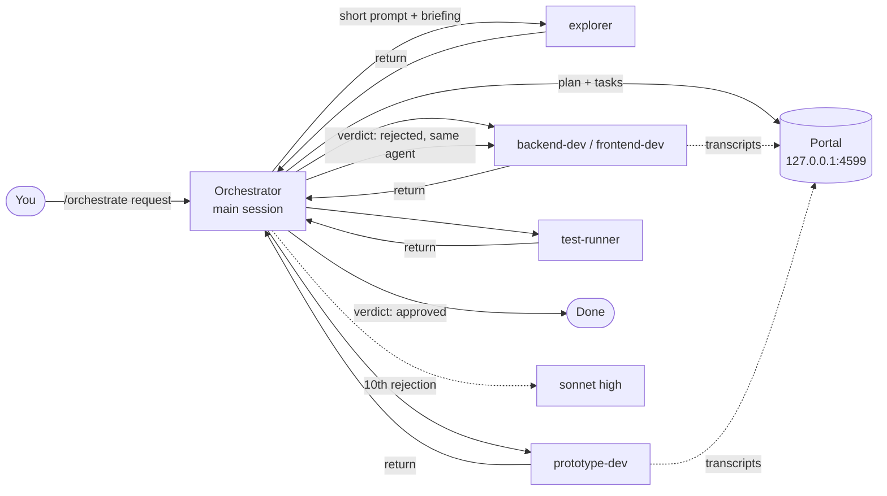

# orchestrate

**A [Claude Code](https://claude.com/claude-code) skill that runs a request through a cheap-first multi-agent workflow, with a live isometric "circuit" portal that shows what every agent is doing.**

🇧🇷 [Leia em português](README.pt-BR.md)


> The GIF above is the portal playing its built-in **example data** (labelled `DADOS DE EXEMPLO` in the UI). Nothing in it comes from a real session.

## What it does

`/orchestrate <request>` turns the main Claude Code session into an orchestrator that follows a fixed set of rules:

1. **Plan first.** The request is split into tasks with an ID, an owner, exclusive file paths and a verifiable acceptance criterion (ideally a command that exits 0).
2. **Haiku first.** Subagents run on `haiku`. Sonnet is used only after **10 rejected deliveries** of the same task, and the orchestrator stops after **3 more** rejections on sonnet.
3. **Short prompts.** A delegation prompt is at most 12 lines and points to a briefing file instead of pasting context.
4. **A report is not proof.** The orchestrator checks every criterion with its own evidence (diff, execution, screenshot) before accepting.
5. **Errors go back to the same agent**, which still holds the context, instead of spawning a new one.
6. **Visual work passes a prototype gate.** N prototypes are produced and the user picks one before the final version.



## The portal

On every invocation the skill starts a small local server (Node, no dependencies, bound to `127.0.0.1` only) and prints its URL as the first line of the reply. It shows, on a single screen:

- an isometric **circuit map**: the orchestrator is the hub and each agent type is a station on a branch, with state, run count, active task and a packet running along the branch for every new message. Several runs of the same type share one station;
- a **task board** (queue, in progress, validation, returned, approved);
- a **communication log** (delegations, returns, verdicts, returns to the agent).

Click a station to open its runs, tokens, prompt, steps and final return. Light and dark themes follow the system or the theme button. No external fonts or CDN: it works offline.

It reads the Claude Code session transcripts on its own. What only the orchestrator knows (tasks, messages, verdicts) is pushed through `emit.mjs`.

| Light | Dark | Mobile |
|---|---|---|
|  |  |  |

> **Language note.** The portal UI, the `emit.mjs` subcommands and flags (`tarefa`, `fala`, `veredito`, `escalada`, `--titulo`, `--dono`, …) and the task state names are in **Portuguese**. The skill instructions (`SKILL.md`) and this documentation are in English; `SKILL.md` tells the model the exact Portuguese commands to use. A translated UI is not done yet.

The visual rules (tokens, isometric geometry, the no-overlap check) are in [`skills/orchestrate/references/portal-system-design.md`](skills/orchestrate/references/portal-system-design.md) (in Portuguese).

## Requirements

- Claude Code with skills and subagents support.
- Node.js 24 (the version the code was developed and tested on; older versions are not verified).
- Tested on Windows 11 only. Nothing in the code is Windows-specific, but macOS and Linux are unverified.

## Install

The skill is the folder `skills/orchestrate/`. Pick one location.

**Personal (all projects):**

```bash
git clone https://github.com/edilsonvilarinho/orchestrator.git
cd orchestrator
mkdir -p ~/.claude/skills
cp -r skills/orchestrate ~/.claude/skills/orchestrate
```

PowerShell:

```powershell
New-Item -ItemType Directory -Force "$HOME\.claude\skills" | Out-Null
Copy-Item -Recurse skills\orchestrate "$HOME\.claude\skills\orchestrate"
```

**One project only:** copy to `<project>/.claude/skills/orchestrate/`.

Restart Claude Code (or start a new session) so it picks up the skill. Check that `/orchestrate` appears in the slash-command list.

### Agents (configured per project on first run)

On the first `/orchestrate` in a project, the skill detects that the agents are not configured yet (none of the five in `<project>/.claude/agents/` and no recorded choice) and, before planning:

1. reads only the project manifests (`package.json`, `pom.xml`, `build.gradle*`, `go.mod`, `Cargo.toml`, `pyproject.toml`, `*.csproj`/`*.sln`) and shows the stack and test/build commands it found;
2. asks whether to **install the agents for this project** or **use the generic ones**;
3. on install, writes `explorer`, `test-runner`, `backend-dev`, `frontend-dev` and `prototype-dev` to `<project>/.claude/agents/` (from `skills/orchestrate/agents/`, already `model: haiku` and `effort: high`), each with a `Project context` section holding stack, commands and rule files (`CLAUDE.md`, `AGENTS.md`). An existing agent is never overwritten.

Commands from `package.json` scripts are treated as declared; the rest (e.g. `mvn test`) are the ecosystem default and are marked **convention, not verified**. Nothing is inferred beyond the manifests.

If the new agents do not show up for delegation, restart the session (or use `/agents`) and repeat the request. To redo it: delete `<project>/.claude/escritorio/agentes.json` or run `node <skill>/setup/agentes.mjs instalar --sobrescrever`.

The orchestrator itself is your main session; it needs no agent file.

## Use

In a Claude Code session, inside the project you want to work on:

```text
/orchestrate add rate limiting to the public API and cover it with tests
/orchestrate --prototypes 3 redesign the settings screen
/orchestrate --no-portal add rate limiting to the public API
/orchestrate --design-system ./design-system redesign the settings screen
```

Call options:

| Option | Effect |
|---|---|
| `--prototypes N` | Number of prototypes per visual deliverable (default 4). |
| `--design-system <path>` | Location of the project's design system; the `explorer` researches it and visual tasks use it. See below. |
| `--no-portal` | Runs without the portal, with the same flow control. See below. |

What happens:

1. The first line of the reply is the portal URL (default `http://127.0.0.1:4599/`). The browser opens once.
2. The orchestrator plans, registers each task in the portal and delegates with short prompts.
3. You follow the circuit, board and log live. Agents' own work is read from the transcripts.
4. Each delivery is verified. A rejected one goes back to the same agent; the 10th rejection on haiku escalates to sonnet.
5. For visual work, it stops after generating `--prototypes N` prototypes (default 4) under `prototipos/<deliverable>/` and waits for your choice. The gallery is served by the portal at `/prototipos/<deliverable>/`.
6. The final report states what was verified, what was not, token cost per agent and rejections per task.

### Project design system (`--design-system <path>`)

Point at your project's design system file or folder: `/orchestrate --design-system ./design-system <request>`. Before planning any visual deliverable, the orchestrator delegates to the `explorer` (haiku, read-only) a search for tokens (colors, type, spacing), components with usage rules and written guidelines. The return (`file:line` pointers, at most 20 lines) becomes a briefing, and every visual task points to it and to the design-system files. Prototypes use existing tokens and components only; anything new needs your permission. Only a local path is accepted (not a URL or a Figma link). If the path does not exist or nothing usable is found, the skill stops and tells you instead of inventing one. Without the option, on visual work it looks for a design system inside the project.

### Without the portal (`--no-portal`)

Pass `--no-portal` in the call to run without the portal: no server starts, no browser opens, no URL is printed. The flow control is the same: a plan with tasks and verifiable criteria, haiku first, validation with the orchestrator's own evidence, returns to the same agent, escalation to sonnet only on the 10th rejection and a stop on the 3rd on sonnet. The `emit.mjs` calls still run, because the log in `.claude/escritorio/<session>.jsonl` is what counts rejections; `emit.mjs` takes `--sessao` and does not depend on the server.

What changes: there is no live view; the prototype gallery is opened straight from the `prototipos/<deliverable>/index.html` files (the skill gives you the paths); and the final report says the per-agent token cost was not measured, since it comes from the portal.

### Commands the orchestrator uses

You normally never type these; they are what `SKILL.md` instructs the model to run.

```bash
# register / update a task
node <skill>/portal/emit.mjs tarefa --id T1 --titulo "Title" --dono backend-dev --estado fila
# say something in the log
node <skill>/portal/emit.mjs fala --de am --para backend-dev --tarefa T1 --texto "Task is yours."
# verdict: aprovada | devolvida (prints the rejection count and the next action)
node <skill>/portal/emit.mjs veredito --tarefa T1 --resultado devolvida --texto "Test X fails."
# escalate after the 10th rejection on haiku
node <skill>/portal/emit.mjs escalada --tarefa T1
```

### Portal options

```bash
node <skill>/portal/start.mjs --sessao <session-id> [--porta 4599] [--abrir nao]   # idempotent
node <skill>/portal/server.mjs --replay <session-id> --velocidade 20               # replay an old session
```

| Variable | Meaning |
|---|---|
| `PORTAL_RAIZ` | Project root to observe. Falls back to `CLAUDE_PROJECT_DIR`, then the current directory. |
| `PORTAL_PROJETOS` | Directory with Claude Code transcripts. Default `~/.claude/projects`. |

The portal writes its state under `<project>/.claude/escritorio/` (`portal.json` and one `<session>.jsonl` of orchestrator events). Add that folder to `.gitignore`.

Full data contract (sources, HTTP API, SSE, state shapes): [`skills/orchestrate/references/portal-contract.md`](skills/orchestrate/references/portal-contract.md) (in Portuguese).

## Limits and caveats

- The Claude Code transcript format is **not a public API**. The collector ignores unknown lines, but a format change can degrade the portal.
- Rejection limits (10 on haiku, 3 on sonnet) are constants in `portal/emit.mjs` (`LIMITE_REPROVACOES`). The counting comes from the session log, not from the model's memory.
- Agent types known to the portal are fixed in `portal/collector.mjs` (`TIPOS_AGENTE`); others are drawn as generic.
- The skill reduces the *orchestration overhead* by design (haiku default, short prompts); it does not guarantee a specific saving. Measure on your own sessions with the per-agent token totals the portal shows.

## Tests

```bash
npm test        # node --test "skills/orchestrate/**/*.test.mjs"  (41 tests, no dependencies)
```

## License

[MIT](LICENSE).
